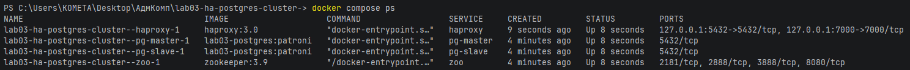
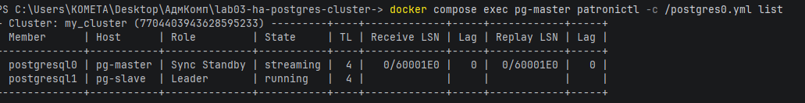
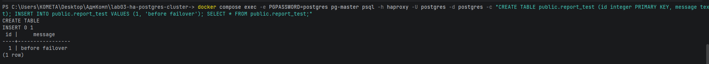
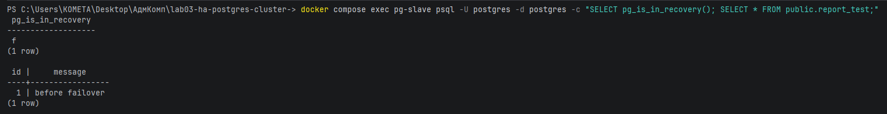
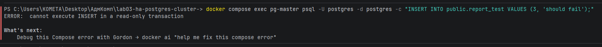
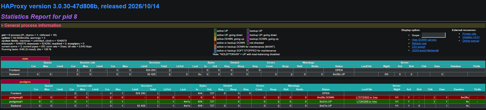
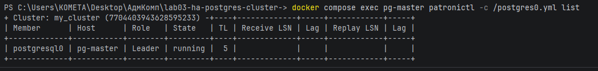
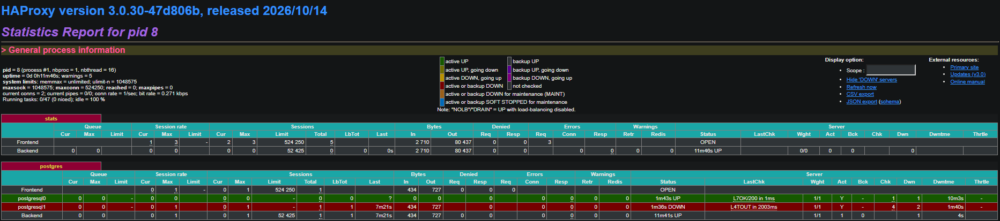
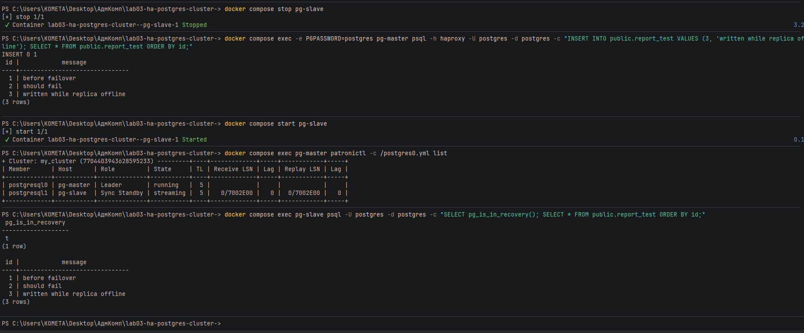

# Лабораторная работа №3 (1) — HA PostgreSQL Cluster

## Описание

Цель работы — развернуть отказоустойчивый кластер PostgreSQL с использованием Docker, Patroni, ZooKeeper и HAProxy.

Необходимо настроить две ноды PostgreSQL, организовать репликацию данных между ними и проверить поведение кластера при отключении основного сервера.

## Используемые технологии

- PostgreSQL 15 — база данных.
- Patroni — управление кластером и переключением лидера.
- ZooKeeper — координация узлов кластера.
- HAProxy — перенаправление подключений на активную ноду.
- Docker / Docker Compose — развёртывание сервисов.

## План работы

### Этап 1. Создание структуры проекта

- [x] Добавить участников проекта.
- [x] Создать первоначальную структуру файлов:
  - `Dockerfile`
  - `docker-compose.yml`
  - `postgres0.yml`
  - `postgres1.yml`
  - `haproxy.cfg`
  - `.gitignore`
  - `README.md`
- [x] Создать директорию `screenshots/` для отчёта.

### Этап 2. Подготовка Docker-образа PostgreSQL

- [x] В `Dockerfile` указать базовый образ PostgreSQL 15.
- [x] Добавить установку необходимых системных зависимостей.
- [x] Создать Python-окружение для Patroni.
- [x] Установить Patroni с поддержкой ZooKeeper.
- [x] Настроить копирование конфигурационных файлов Patroni в образ.
- [x] Настроить переменные окружения и пользователя контейнера.
- [x] Проверить сборку Docker-образа.

Обычная сборка требует `postgres0.yml` и `postgres1.yml`. Сборка и проверки этапа 2 успешно выполнены участником проекта.

### Этап 3. Настройка Patroni и PostgreSQL

- [x] Настроить `postgres0.yml` для первой ноды:
  - имя кластера и узла;
  - REST API Patroni;
  - адрес ZooKeeper;
  - параметры инициализации кластера;
  - параметры репликации PostgreSQL;
  - пользователей и аутентификацию;
  - директорию хранения данных.
- [x] На основе первой конфигурации настроить `postgres1.yml`.
- [x] Указать для второй ноды собственные имя, адреса и директорию данных.
- [x] Проверить согласованность конфигураций обеих нод.

Запуск кластера и проверка репликации выполнены на этапах 4–5.

### Этап 4. Настройка Docker Compose и запуск кластера

- [x] Добавить в `docker-compose.yml` сервис ZooKeeper.
- [x] Настроить запуск ZooKeeper.
- [x] Добавить сервис первой ноды PostgreSQL.
- [x] Добавить сервис второй ноды PostgreSQL.
- [x] Для обеих нод указать:
  - созданный Docker-образ;
  - команды запуска Patroni;
  - volumes для хранения данных.
- [x] Запустить проект через Docker Compose.
- [x] Проверить состояние контейнеров.
- [x] Проверить логи ZooKeeper и Patroni.
- [x] Убедиться, что одна нода получила роль лидера, а вторая стала репликой.

### Этап 5. Проверка репликации PostgreSQL

- [x] Подключиться к обеим нодам через PostgreSQL-клиент.
- [x] Определить текущего лидера кластера.
- [x] Создать тестовую таблицу на лидере.
- [x] Добавить несколько записей.
- [x] Проверить появление таблицы и записей на реплике.
- [x] Попробовать выполнить операцию записи на реплике.
- [x] Убедиться, что реплика работает в режиме только для чтения.
- [x] Сохранить результаты проверок и скриншоты.

### Этап 6. Настройка HAProxy

- [x] В `haproxy.cfg` настроить основные параметры HAProxy.
- [x] Добавить интерфейс статистики HAProxy.
- [x] Настроить TCP-подключение к PostgreSQL.
- [x] Настроить проверку роли узлов через REST API Patroni.
- [x] Добавить обе ноды PostgreSQL в конфигурацию HAProxy.
- [x] Добавить сервис HAProxy в `docker-compose.yml`.
- [x] Настроить порты и подключение конфигурационного файла.
- [x] Запустить обновлённый проект.
- [x] Проверить запуск HAProxy и доступность его интерфейса статистики.
- [x] Подключиться к PostgreSQL через HAProxy.
- [x] Убедиться, что подключения направляются на текущего лидера.

### Этап 7. Проверка отказоустойчивости

- [x] Определить текущего лидера кластера.
- [x] Проверить чтение и запись через HAProxy до отключения.
- [x] Остановить контейнер лидера.
- [x] Проверить логи Patroni и ZooKeeper.
- [x] Определить, произошло ли переключение лидера.
- [x] Проверить состояние узлов через HAProxy.
- [x] Повторить запросы на чтение и запись через HAProxy.
- [x] Зафиксировать результаты и возможные ошибки.
- [x] Запустить остановленный контейнер обратно.
- [x] Проверить состояние кластера после восстановления.
- [x] Описать поведение системы при остановке лидера.

### Этап 8. Подготовка отчёта

- [x] Добавить в README описание выполненных этапов.
- [x] Разместить скриншоты основных проверок.
- [x] Описать возникшие проблемы и способы их решения.
- [x] Ответить на вопросы из методички.
- [x] Написать общий вывод по лабораторной работе.
- [x] Проверить актуальность инструкций и файлов проекта.

## Ожидаемый результат

В результате выполнения работы должен быть развёрнут кластер PostgreSQL из двух узлов.

Необходимо продемонстрировать:

- Работу Patroni и ZooKeeper.
- Репликацию данных между узлами.
- Ограничение записи на резервной ноде.
- Подключение к базе данных через HAProxy.
- Поведение кластера после отключения мастера.

## Отчёт

### Запуск кластера

Собран образ PostgreSQL 15 с Patroni. Через Docker Compose запущены два узла PostgreSQL, ZooKeeper и HAProxy.



Роли проверены командой:

```powershell
docker compose exec pg-master patronictl -c /postgres0.yml list
```

Один узел получил роль Leader, второй — Sync Standby. Реплика находилась в состоянии streaming.




Проверены логи ZooKeeper и Patroni. Patroni на узле postgresql0 сообщает об удержании блокировки лидера, а на postgresql1 — о работе репликой и следовании за postgresql0. В просмотренном фрагменте повторяющихся ошибок нет. В логах ZooKeeper зафиксированы закрытия соединений и истечение сессий во время остановок контейнеров.

### Репликация и запрет записи

Через HAProxy создана таблица `report_test` и добавлена запись:

```sql
CREATE TABLE public.report_test (
    id integer PRIMARY KEY,
    message text
);

INSERT INTO public.report_test VALUES (1, 'before failover');
SELECT * FROM public.report_test;
```



На втором узле проверены роль и содержимое таблицы:

```sql
SELECT pg_is_in_recovery();
SELECT * FROM public.report_test;
```



После уточнения ролей выполнена попытка INSERT на реплике `pg-master`:

```sql
INSERT INTO public.report_test VALUES (3, 'should fail');
```

Получена ожидаемая ошибка:

```text
ERROR: cannot execute INSERT in a read-only transaction
```



Ранее попытка записи была выполнена на `pg-slave` и завершилась успешно, поскольку он являлся лидером. Поэтому в таблице сохранилась запись с текстом `should fail`. Она не свидетельствует о записи на реплику.

### HAProxy и переключение лидера

HAProxy принимает подключения на порту 5432 и проверяет роль узлов запросом `GET /primary` к API Patroni на порту 8008. Подключения направляются на узел, который отвечает HTTP 200.

До отключения лидером являлся `pg-slave`.



Лидер остановлен командой:

```powershell
docker compose stop pg-slave
```

После остановки `pg-master` стал лидером. HAProxy изменил сервер, на который направляются новые подключения.


Переключение подтверждено сообщениями Patroni и PostgreSQL:

```text
pg-master-1 | 2026-11-04 20:56:52,369 INFO: promoted self to leader by acquiring session lock
pg-master-1 | server promoting
pg-master-1 | 2026-11-04 20:56:52.371 UTC [38] LOG: received promote request
```

Patroni получил блокировку лидера и инициировал повышение PostgreSQL из реплики в основной узел.





В первом прогоне после переключения через HAProxy успешно выполнены чтение и вставка в таблицу `ha_test`. Запрос `pg_is_in_recovery()` вернул `f`, подтверждая подключение к лидеру.

Использовалась штатная остановка контейнера. Точное время переключения не измерялось.

### Возвращение узла

Остановленный узел запущен командой:

```powershell
docker compose start pg-slave
```

После запуска `pg-slave` присоединился как синхронная реплика. Состояние — streaming, отставание в выводе `patronictl` — 0.

Дополнительно выполнялась проверка получения данных после временного отключения реплики: реплика останавливалась, на лидере добавлялась запись, затем реплика запускалась повторно.



Логи первого прогона: [failover-logs.txt](screenshots/failover-logs.txt).

## Проблемы в ходе работы

- Для работы Docker Desktop потребовалось включить компонент Virtual Machine Platform и перезагрузить компьютер.
- HAProxy требовал перевод строки в конце `haproxy.cfg`. После добавления перевода строки сервис запустился.

## Ответы на вопросы

### Чем отличаются ports и expose?

`ports` публикует порт контейнера на компьютере. `expose` обозначает внутренний порт без публикации на хосте. Контейнеры общей сети могут обращаться друг к другу и без `expose`.

### Пересобирается ли образ при перезапуске?

Нет. `docker compose restart` только перезапускает контейнеры.

После изменения Dockerfile или конфигураций, копируемых через COPY, нужно пересобрать образ и обновить контейнеры:

```powershell
docker compose build
docker compose up -d
```

Неизменившиеся шаги сборки могут использовать кеш.

`haproxy.cfg` подключён напрямую через bind mount. Для применения изменений достаточно перезапуска HAProxy:

```powershell
docker compose restart haproxy
```

## Вывод

Развёрнут кластер PostgreSQL из двух узлов под управлением Patroni. Проверены передача данных на реплику и запрет записи на ней. HAProxy направляет подключения на текущего лидера.

После остановки лидера второй узел получил его роль. Вернувшийся узел присоединился как реплика.

Стенд работает на одном компьютере, поэтому отказ самого компьютера или единственных экземпляров ZooKeeper и HAProxy отдельно не покрывается.
